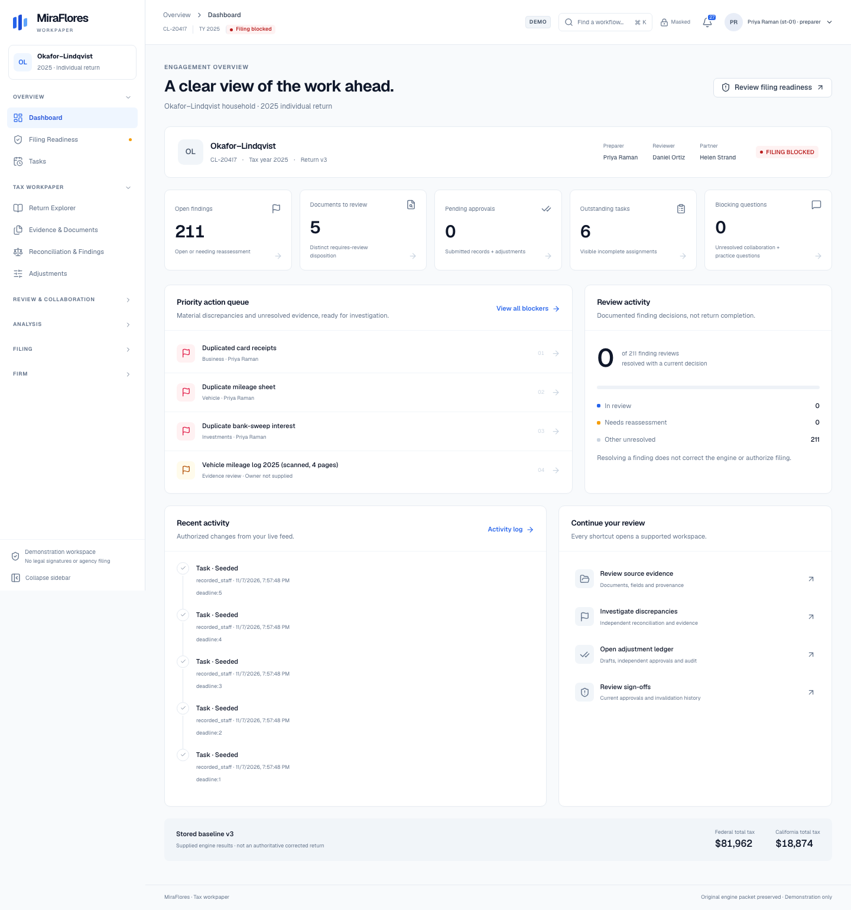
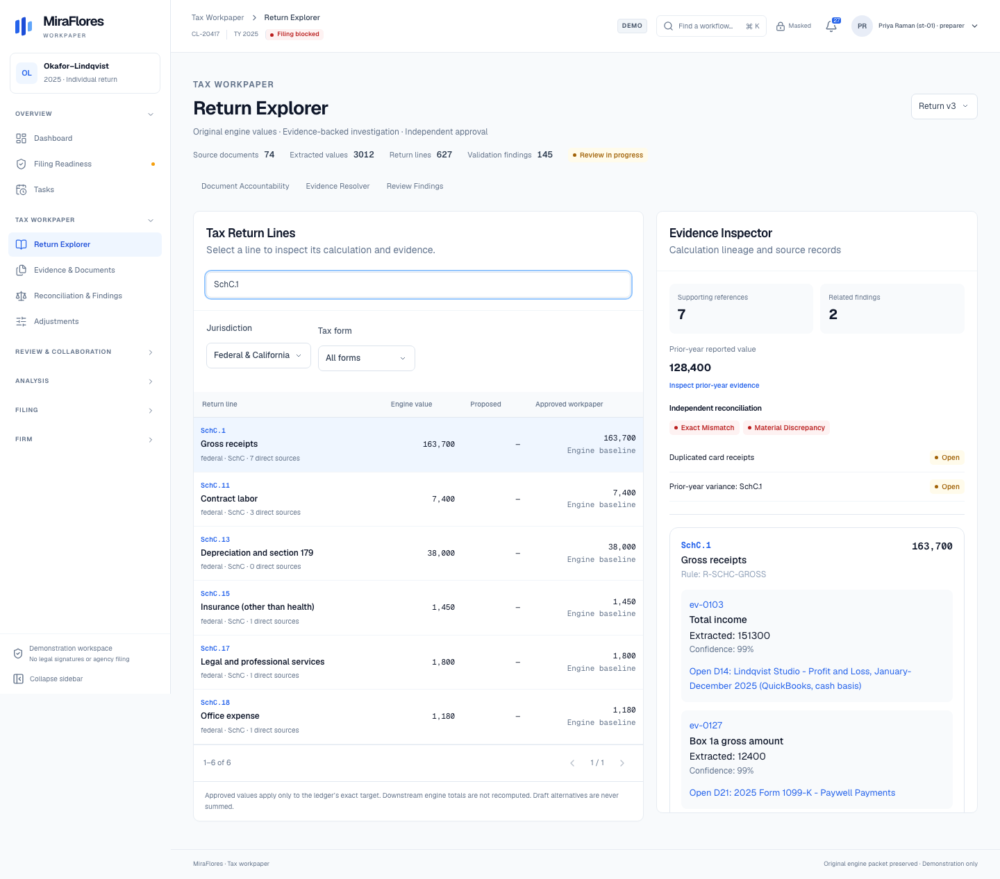
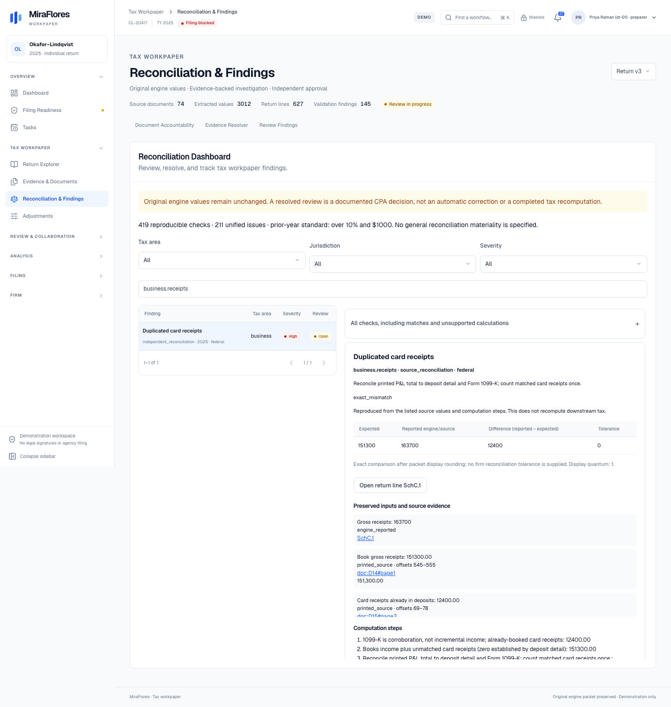
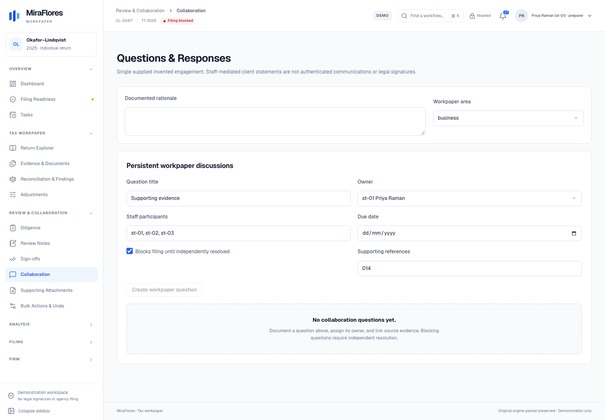
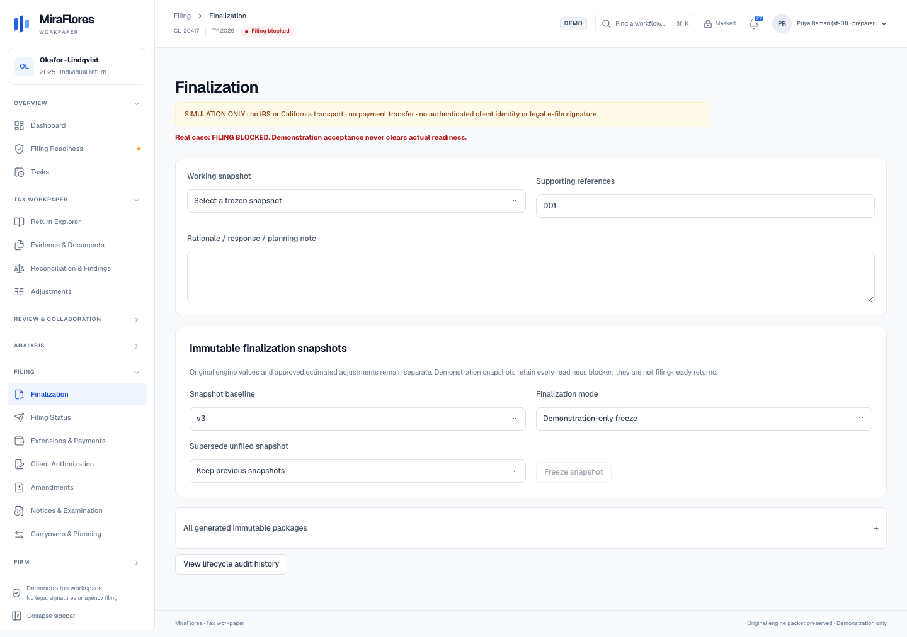
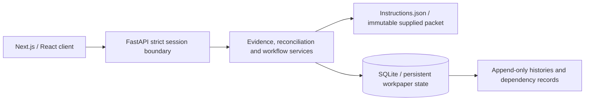

# MiraFlores Tax Workpaper

**An evidence-backed tax preparation and CPA review workspace.**

MiraFlores connects return lines, source documents, independent reconciliations, proposed adjustments, and documented review decisions in one auditable application. Built around the supplied Okafor–Lindqvist case study, it includes 74 documents and three stored return versions, with a FastAPI backend, a Next.js frontend, and persistent SQLite workflows.

> **Demonstration only.** The real case-study packet remains **FILING BLOCKED**. Staff selection is not authenticated identity assurance, sign-offs are not legal electronic signatures, and simulated filing never submits a return or transfers a payment to the IRS or California FTB.



[Quick start](#quick-start) · [Features](#features) · [Architecture](#architecture) · [Testing](#testing) · [Documentation](#documentation)

## Features

| Workspace | What it supports |
| --- | --- |
| **Engagement dashboard** | Authorized metrics, staff assignments, priority blockers, review progress, recent activity, and workflow shortcuts |
| **Return explorer** | Searchable federal and California lines, calculation lineage, prior-year evidence, and separate engine, proposed, and approved workpaper values |
| **Evidence & documents** | Document accountability, reverse tracing, typed evidence resolution, simulated field highlighting, CPA verification, and verification history |
| **Reconciliation & findings** | Independent comparisons with preserved inputs, expected/reported values, tolerances, unsupported-check explanations, and persistent review decisions |
| **Audited adjustments** | Draft, submitted, approved, rejected, reversed, and superseded states; conflict detection; independent approval; partner tax-effect thresholds |
| **Firm workflow** | Assignments, diligence, blocking review notes, immutable policy revisions, scoped sign-offs, dependency-aware invalidation, and filing-readiness checks |
| **Change analysis** | v1/v2/v3 comparison, packet-supported what-if alternatives, timeline replay, and scoped change-impact assessment |
| **Filing & post-filing** | Immutable snapshots, extensions/payments, bound client authorization, simulated submission outcomes, amendments, notices/examination packages, and next-year handoff |
| **Collaboration & operations** | Recoverable live changes, personal checkpoints, secure evidence attachments, threaded questions, atomic bulk actions with audited undo, time entries, budgets, and deadlines |

The interface includes grouped sidebar navigation, contextual inspectors, paginated findings, a notification/activity drawer, keyboard-accessible dialogs, and responsive desktop/mobile layouts.

<details>
<summary>Explore the interface</summary>

### Return explorer



### Reconciliation



### Collaboration



### Filing lifecycle



[View the mobile dashboard](docs/ui-redesign/mobile.png).

</details>

## Quick start

### Prerequisites

- Git
- Python 3.13 and `venv`
- Node.js 22 and npm

The latest documented verification used Python **3.13.5** and Node.js **22.23.2**. Dependency versions are pinned in `backend/requirements.txt` and `frontend/package-lock.json`.

### 1. Clone and install

```sh
git clone https://github.com/parthacs1999/miraflores-workpaper.git
cd miraflores-workpaper
git switch feature/complete-workpaper

python3.13 -m venv backend/.venv
backend/.venv/bin/python -m pip install -r backend/requirements.txt

cd frontend
npm ci
cd ..
```

The commands below use a macOS/Linux shell. On Windows, use the corresponding virtual-environment Python executable under `backend/.venv/Scripts/`.

### 2. Start the backend

In the first terminal:

```sh
cd backend
.venv/bin/python run_secure.py --demo
```

The API runs at **http://localhost:8000**. The `--demo` flag explicitly enables local development staff selection; the default launcher remains locked without a configured session provider.

SQLite is initialized on first use, with additive migrations applied automatically. The default local database is `backend/data/reviews.db`; existing records are retained. To use a separate database, set `REVIEW_DB_PATH` to an absolute writable path before starting the backend. Local databases and credentials are excluded from Git.

### 3. Start the frontend

In a second terminal:

```sh
cd frontend
npm run dev
```

Open **http://localhost:3000**.

The frontend defaults to `http://localhost:8000` for API requests. If you need an explicit override, add this line to `frontend/.env.local`, preserving any existing settings:

```dotenv
NEXT_PUBLIC_API_URL=http://localhost:8000
```

Restart Next.js after changing the API URL. Production builds capture this value at build time.

### 4. Select a demonstration session

Choose a staff member and click **Start / switch session**:

| Staff ID | Staff member | Role |
| --- | --- | --- |
| `st-01` | Priya Raman | Preparer |
| `st-02` | Daniel Ortiz | Reviewer |
| `st-03` | Helen Strand | Partner |
| `st-05` | Jo Kimura | Firm administrator |

Use the top-right identity menu to switch or end a session. Available workspaces and actions depend on backend permissions, engagement assignments, and clearance. Administrator access is operational and does not grant unrestricted tax-detail access.

### Local configuration

| Setting | Purpose |
| --- | --- |
| `NEXT_PUBLIC_API_URL` | Frontend API address; default `http://localhost:8000` |
| `REVIEW_DB_PATH` | Optional backend SQLite database path |
| `WORKPAPER_ORIGINS` | Exact allowed frontend origins, comma-separated; demo default `http://localhost:3000` |
| `PORT` | Backend port; default `8000` |

Use **localhost consistently** for the browser and API. Mixing `localhost` and `127.0.0.1` can interfere with SameSite cookies. A different frontend port requires a matching `WORKPAPER_ORIGINS` setting. Cookies, Origin validation, and CSRF checks remain mandatory.

## Try the primary case-study workflow

1. Open the Dashboard as Priya, then **Tax Workpaper → Return Explorer**.
2. Search for `SchC.1` and inspect Gross receipts, its source lineage, prior-year evidence, and related findings.
3. Open **Reconciliation & Findings**, search `business.receipts`, and inspect the duplicated-card-receipts issue: **151,300 expected**, **163,700 reported**, and a **12,400 difference**.
4. Follow the evidence references into the simulated source documents. Automatic matching and CPA-confirmed verification remain distinct.
5. Use **Adjustments** to prepare a documented correction. Submission and approval remain separate; applicable partner approval is enforced on the server. The original engine packet is never overwritten.
6. Open the bell for **Since I last looked**, reconnect recovery, and your personal checkpoint.
7. Explore **Analysis** for stored-version comparisons, supported alternatives, and historical replay.
8. Open **Filing Readiness** to inspect the actual blockers. Demonstration snapshots or simulated acceptance do not clear authoritative prerequisites.

See the [complete redesign walkthrough](UI_REDESIGN.md#demonstration-walkthrough) and phase documentation for detailed approval and lifecycle demonstrations.

## Architecture



- **Frontend:** Next.js 16, React 19, TypeScript, Tailwind CSS 4, Geist typography, and Lucide icons.
- **Backend:** FastAPI, Pydantic, domain services, and server-side authorization/redaction.
- **Persistence:** SQLite, six additive migration scripts, append-only histories, revision checks, and dependency-bound approvals.
- **Live updates:** Bounded long polling with authorized metadata, reconnect recovery, and persistent reviewer checkpoints.
- **Evidence:** Packet references and source text remain traceable; uploaded supporting originals are immutable and are not automatically extracted or verified.

```text
miraflores-workpaper/
├── backend/
│   ├── app/
│   │   ├── services/          # Evidence, tax comparisons and workflow logic
│   │   ├── migrations/        # Additive SQLite migrations
│   │   └── main.py            # FastAPI application and route integration
│   ├── data/Instructions.json # Immutable case-study packet
│   ├── tests/                 # Isolated backend tests
│   └── run_secure.py          # Explicit local-demo / secure launcher
├── frontend/
│   ├── src/app/               # Next.js application and shared styling
│   ├── src/components/        # Domain workspaces, shell and UI primitives
│   ├── tests/                 # Legacy browser regression suite
│   └── workflow-tests/        # Strict workflow/security and redesign tests
├── docs/                      # Original case-study PDF and UI screenshots
├── PHASE1.md … PHASE7.md      # Engineering records and acceptance results
└── UI_REDESIGN.md             # Design system, manifest and walkthrough
```

## Security and calculation boundaries

- The backend fails closed by default. Local demo mode is explicit and forbidden in production; the legacy unauthenticated profile is restricted to isolated local regression tests.
- Authorization, staff independence, approval thresholds, sensitive-data redaction, and access auditing are enforced server-side.
- Session switching clears the previous workspace and invalidates stale requests. Protected original downloads require clearance, a documented purpose, and access auditing.
- Original engine values remain separate from approved adjustment estimates. The frontend does not recompute downstream tax totals.
- Tax effects and scenarios are limited to methods/results supplied by the packet. Missing inputs and unsupported interactions remain explicit.
- The supplied case is a single-engagement prototype. It is **not production identity infrastructure, a legal e-signature platform, an authoritative tax engine, or an agency filing integration**.

Keep runtime databases, credentials, original uploads, and generated test artifacts out of source control. Detailed security limitations and remaining case-study gaps are documented in [PHASE4.md](PHASE4.md), [PHASE7.md](PHASE7.md), and [UI_REDESIGN.md](UI_REDESIGN.md#known-limitations).

## Testing

Latest recorded verification: **528 tests passed**—474 backend tests, 14 legacy browser tests, and 40 strict browser tests. This preserves the original 516 tests and adds 12 redesign regressions. TypeScript, ESLint, webpack production builds, and SQLite integrity checks also passed. Results are recorded in [UI_REDESIGN.md](UI_REDESIGN.md#verification); this is a local verification record, not a hosted CI badge.

From the repository root:

```sh
PYTHONDONTWRITEBYTECODE=1 PYTHONPATH=backend backend/.venv/bin/python -m pytest backend/tests -q
```

From `frontend/`:

```sh
# First-time browser installation
npx playwright install chromium

# Static checks
npx tsc --noEmit
npm run lint

# Run the browser suites sequentially
npm run test:e2e
npm run test:e2e -- --config=playwright.workflow.config.ts

# Verify the webpack production bundle in an isolated build directory
NEXT_DIST_DIR=.next-ui-verification NEXT_PUBLIC_API_URL=http://localhost:8000 npm run build -- --webpack
```

The browser suites start their own production frontend and backend servers with disposable SQLite databases. Keep ports **3100/8100** and **3200/8200** free. Do not point regression tests at an existing workpaper database.

## Troubleshooting

| Symptom | What to check |
| --- | --- |
| Session provider is locked or the staff selector is empty | Start the backend with `run_secure.py --demo`, check the displayed API URL, and use **Retry session initialization**. A plain default backend launch intentionally remains locked. |
| Cannot reach the backend | Check `http://localhost:8000/health`, port availability, and `NEXT_PUBLIC_API_URL`. |
| Cookie, Origin, or CSRF failures | Use `localhost` consistently; match the frontend origin in `WORKPAPER_ORIGINS`; reload and select a fresh session after switching configuration. |
| Demo launcher rejects configuration | Check for conflicting `WORKPAPER_ENV` or `WORKPAPER_MODE` values. The demo flag cannot override production/security settings. |
| A workspace or action is denied | Check the active role, engagement assignment, clearance, and independence requirements. Do not enable the regression profile to bypass them. |
| Filing remains blocked | This is expected until the real authoritative prerequisites are satisfied. Scripted events and demonstration approvals do not make the packet filing-ready. |

## Documentation

| Document | Coverage |
| --- | --- |
| [Original case study](docs/Case_Study_Redesign_the_Tax_Workpaper%20l%20MiraFlores%20AI.pdf) | Product brief and supplied engagement scenario |
| [Phase 1](PHASE1.md) | Audited tax adjustments |
| [Phase 2](PHASE2.md) | Evidence resolution and document accountability |
| [Phase 3](PHASE3.md) | Independent reconciliation and unified findings |
| [Phase 4](PHASE4.md) | Firm workflow, permissions, and filing readiness |
| [Phase 5](PHASE5.md) | Version comparison, what-if analysis, and timeline replay |
| [Phase 6](PHASE6.md) | Simulated filing and post-filing lifecycle |
| [Phase 7](PHASE7.md) | Collaboration, bulk actions, attachments, operations, and hardening |
| [UI redesign](UI_REDESIGN.md) | Design system, exact file manifest, screenshots, tests, and complete walkthrough |

## Restricted deployment preparation

Deployment has not been performed. Review [DEPLOYMENT.md](DEPLOYMENT.md), [DEPLOYMENT_SECURITY.md](DEPLOYMENT_SECURITY.md), and [DEPLOYMENT_READINESS.md](DEPLOYMENT_READINESS.md) for hosted startup, verified identity access, persistent SQLite, configuration, tests and outstanding release gates. Public demo staff impersonation is not permitted.

For a separate disposable, token-restricted $0 assignment profile, see [FREE_DEPLOYMENT.md](FREE_DEPLOYMENT.md). Vercel Hobby eligibility and packet-sharing approval are required; a scheduled local HTTPS tunnel is documented as the fallback. This does not replace the secure hosted profile.
